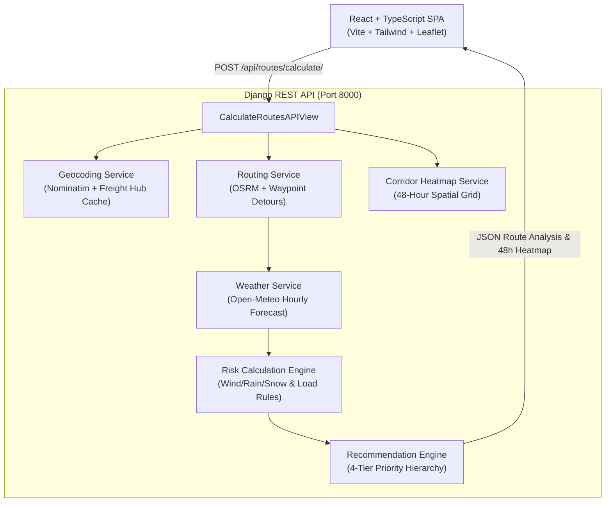

# Spotter — Weather-Aware Truck Routing Engine

[](https://www.python.org/)
[](https://www.djangoproject.com/)
[](https://react.dev/)
[](https://tailwindcss.com/)
[](https://leafletjs.com/)
[](https://www.docker.com/)
[](https://docs.pytest.org/)

> **Full Stack Developer Assessment** — Weather-Aware Truck Routing web application built with **React + TypeScript** and **Django REST Framework**. Helps commercial truck drivers and logistics dispatchers choose the safest and fastest route based on real-time weather forecasts, truck cargo weight, and cumulative travel times.

---

## Table of Contents
1. [System Architecture](#system-architecture)
2. [Specification Alignment & Features](#specification-alignment--features)
3. [Risk & Recommendation Rules](#risk--recommendation-rules)
4. [Quick Start (Docker & Local)](#quick-start)
5. [Cloud Deployment Guide (Producción)](#cloud-deployment-guide)
6. [API Reference](#api-reference)
7. [Automated Test Suite](#automated-test-suite)
8. [Loom Video Walkthrough Guide](#loom-video-walkthrough-guide)

---

## System Architecture



---

## Specification Alignment & Features

| Requirement | Implementation Details | Status |
|---|---|:---:|
| **Origin & Destination Entry** | Geocoding with OpenStreetMap Nominatim, freight-hub autocomplete, and coordinates parsing (`lat,lon`). | ✅ Complete |
| **Departure Date/Time** | Native datetime selector; sets vehicle departure timestamp to forecast exact arrival times. | ✅ Complete |
| **Truck Load Weight** | Slider + numeric input (0–80,000 lbs) with real-time feedback on weight classification and active load safety rules. | ✅ Complete |
| **3 Route Options Generated** | OSRM routing engine with geometric waypoint offset generator ensuring 3 viable alternative corridors (Fastest, Northern bypass, Southern corridor). | ✅ Complete |
| **Weather Sampled every 10 / 25 / 50 mi** | Great-circle geodesic distance interpolation calculates checkpoints every $X$ miles with cumulative vehicle ETA progression. | ✅ Complete |
| **Weather Risk Rules & Load Rules** | Full implementation of wind, rain, and snow thresholds + weight-triggered crosswind safety escalations. | ✅ Complete |
| **Route Recommendation Hierarchy** | Strict 4-tier sorting: 1. Fewest Severe miles, 2. Fewest High miles, 3. Lowest avg risk, 4. Shortest travel time. | ✅ Complete |
| **Interactive Map & Checkpoints** | Dark-themed Leaflet map showing all 3 routes, colored checkpoint markers by risk level, and rich telemetry popups. | ✅ Complete |
| **Corridor Weather Heatmap & 0–48h Slider** | Spatial corridor buffer mesh with 0–48 hour timeline scrubbing, animated radar playback, and metric toggles (Risk, Wind, Rain, Snow). | ✅ Complete |

---

## Risk & Recommendation Rules

### 1. Checkpoint Weather Classification Thresholds

| Condition | Low | Moderate | High | Severe | No Travel |
|---|---|---|---|---|---|
| **Wind** | `< 25 mph` | `25–34 mph` | `35–44 mph` | `45–54 mph` | `≥ 55 mph` |
| **Rain** | `< 0.10 in/hr` | `0.10–0.25 in/hr` | `0.25–0.50 in/hr` | `0.50–1.00 in/hr` | `> 1.00 in/hr` |
| **Snow** | `< 0.5 in/hr` | `0.5–1.0 in/hr` | `1.0–2.0 in/hr` | `2.0–3.0 in/hr` | `> 3.0 in/hr` |

### 2. Cargo Load Weight Rules (Crosswind Rollover Modifiers)
- $\ge 55\text{ mph} \rightarrow$ **NO TRAVEL** for any load weight.
- $45–54\text{ mph} + > 30,000\text{ lb} \rightarrow$ **NO TRAVEL** (escalates from Severe to No Travel due to high vehicle rollover risk).
- $35–44\text{ mph} + > 40,000\text{ lb} \rightarrow$ **SEVERE** (escalates from High to Severe due to extreme lateral crosswind force).

### 3. Route Recommendation Priority Hierarchy
Routes are evaluated and ranked strictly by:
1. **Fewest Severe miles** *(includes No-Travel miles to guarantee maximum operator safety)*
2. **Fewest High miles**
3. **Lowest average risk** *(distance-weighted average risk score along route checkpoints)*
4. **Shortest travel time** *(duration in seconds as final tie-breaker)*

---

## Quick Start

### Option A: Docker Compose (Recommended — 1 Command)
Make sure Docker Desktop is running, then execute:

```bash
docker-compose up --build
```

- **Frontend Application:** [http://localhost:3000](http://localhost:3000)
- **Backend API:** [http://localhost:8000/api/health/](http://localhost:8000/api/health/)

---

### Option B: Local Development Setup

#### 1. Backend Setup (Django)
```bash
cd backend

# Create and activate virtual environment
python -m venv .venv

# Windows:
.venv\Scripts\activate
# macOS/Linux:
# source .venv/bin/activate

# Install dependencies
pip install -r requirements.txt

# Run migrations
python manage.py migrate

# Start backend server
python manage.py runserver 0.0.0.0:8000
```

#### 2. Frontend Setup (React + Vite)
In a new terminal:
```bash
cd frontend

# Install dependencies
npm install

# Start Vite dev server
npm run dev
```

Open [http://localhost:5173](http://localhost:5173) in your browser.

---

## Cloud Deployment Guide

La aplicación está completamente preparada para despliegue en producción mediante múltiples estrategias:

### Opción 1: Render.com Blueprint (1-Click Deploy Automático)
El repositorio incluye el archivo [`render.yaml`](render.yaml) para desplegar el backend Django (Python + Gunicorn) y el frontend React (Static Site con reescritura de rutas) de forma coordinada:
1. Conecta tu repositorio de GitHub en [Render Dashboard](https://dashboard.render.com/).
2. Selecciona **Blueprints** -> **New Blueprint Instance**.
3. Selecciona tu repositorio: Render detectará automáticamente `render.yaml` y configurará ambos servicios.
4. El backend se levantará con Gunicorn y WhiteNoise en `/api/` y el frontend se conectará automáticamente.

### Opción 2: Render o Railway (Servicios Individuales)
- **Backend (Python Web Service):**
  - **Root Directory:** `backend`
  - **Build Command:** `pip install -r requirements.txt && python manage.py migrate --noinput && python manage.py collectstatic --noinput`
  - **Start Command:** `gunicorn config.wsgi:application --bind 0.0.0.0:$PORT --workers 3 --timeout 120` (o usa el [`backend/Procfile`](backend/Procfile))
  - **Health Check Path:** `/api/health/`
  - **Variables de Entorno:**
    - `DEBUG=False`
    - `DJANGO_SECRET_KEY=tu-clave-secreta-de-produccion`
- **Frontend (Static Site / Vercel / Netlify):**
  - **Root Directory:** `frontend`
  - **Build Command:** `npm ci && npm run build`
  - **Publish Directory:** `dist`
  - **Variable de Entorno:** `VITE_API_URL=https://tu-backend-en-render.onrender.com/api`

### Opción 3: Docker Compose en Servidor Cloud (AWS EC2 / DigitalOcean / Hetzner)
Para levantar el stack completo en cualquier servidor Linux con Docker instalado:
```bash
docker-compose up -d --build
```
El reverse proxy Nginx del frontend (`:3000`) redirigirá internamente las llamadas a `/api/` hacia el contenedor del backend Django (`:8000`), sin requerir configuración adicional de CORS.

### Publicación en GitHub
Para subir el proyecto a tu repositorio de GitHub para la entrega:
```bash
git remote add origin https://github.com/<tu-usuario>/<tu-repo>.git
git branch -M main
git push -u origin main
```

---

## API Reference

### 1. `POST /api/routes/calculate/`
Calculates 3 driving routes, samples checkpoints every 10/25/50 miles, queries Open-Meteo weather at arrival ETA, applies load rules, ranks routes, and returns 0–48h corridor heatmap timeline.

**Request Body:**
```json
{
  "origin": "Chicago, IL",
  "destination": "Denver, CO",
  "departure_time": "2026-11-01T14:00:00Z",
  "load_weight_lbs": 42000,
  "sampling_miles": 25
}
```

**Response Summary:**
```json
{
  "origin": { "name": "Chicago, IL, USA", "lat": 41.8781, "lon": -87.6298 },
  "destination": { "name": "Denver, CO, USA", "lat": 39.7392, "lon": -104.9903 },
  "recommended_route_id": "route_1",
  "recommended_route_name": "Route 1",
  "recommendation_summary": "0 Severe or No-Travel miles detected along Route 1. Saves 328 minutes vs Route 3.",
  "routes": [ ... 3 detailed route objects with checkpoints & weather ... ],
  "corridor_forecast_48h": [ ... spatial grid points with 48h hourly timelines ... ]
}
```

### 2. `GET /api/routes/geocode/?q=Denver`
Place autocomplete and geocoding endpoint for logistics hubs.

### 3. `GET /api/routes/presets/`
Returns curated test scenarios (e.g. *Chicago → Denver [High Winds]*, *Seattle → Salt Lake City [Mountain Snow]*, *Dallas → Atlanta [Rain front]*).

### 4. `GET /api/health/`
Health check endpoint returning system status and version.

---

## Automated Test Suite

A comprehensive test suite is built into the backend using `pytest` and `pytest-django`.

To execute all 26 unit and integration tests:
```bash
cd backend
.venv/Scripts/python.exe -m pytest -v
```

### Test Coverage Highlights:
- **`routing/tests/test_risk_rules.py`**:
  - Validates exact boundaries for Wind (<25, 25–34, 35–44, 45–54, ≥55 mph).
  - Validates exact boundaries for Rain (<0.10, 0.10–0.25, 0.25–0.50, 0.50–1.00, >1.00 in/hr).
  - Validates exact boundaries for Snow (<0.5, 0.5–1.0, 1.0–2.0, 2.0–3.0, >3.0 in/hr).
  - Validates all 3 Load Rules (≥55 mph No Travel, 45–54 mph + >30k lb No Travel, 35–44 mph + >40k lb Severe).
- **`routing/tests/test_routing_service.py`**:
  - Validates great-circle Haversine formula against verified geographical distances.
  - Validates polyline checkpoint sampling intervals at 10, 25, and 50 miles.
  - Validates 3-route generation guarantees.
- **`routing/tests/test_recommendation_service.py`**:
  - Tests 4-tier sorting hierarchy step-by-step:
    1. Priority 1 (Fewest Severe miles)
    2. Priority 2 (Fewest High miles when Severe miles tied)
    3. Priority 3 (Lowest average risk when Severe & High tied)
    4. Priority 4 (Shortest travel time when risks tied).
- **`routing/tests/test_api_endpoints.py`**:
  - Validates API input serialization, validation errors, and complete end-to-end route calculation.

---

## Loom Video Walkthrough Guide

A complete 5–10 minute script and slide presentation outline is available in [WALKTHROUGH.md](WALKTHROUGH.md).

It covers:
1. System overview and architecture
2. Live interactive walkthrough of the Chicago → Denver heavy freight scenario
3. Demonstration of the 0–48 hour forecast slider and animated weather radar
4. Code review of the risk engine and recommendation algorithm
5. Running the automated test suite and Docker deployment.

---

## Project Structure

```
proyectito/
├── backend/
│   ├── config/                     # Django project configuration & settings
│   ├── routing/
│   │   ├── services/
│   │   │   ├── risk_service.py     # Threshold rules & load weight logic
│   │   │   ├── weather_service.py  # Open-Meteo hourly API & batching
│   │   │   ├── routing_service.py  # OSRM & 10/25/50-mi sampling
│   │   │   ├── corridor_service.py # 48h spatial corridor heatmap grid
│   │   │   ├── geocoding_service.py# Nominatim & freight hubs cache
│   │   │   └── recommendation_service.py # 4-tier priority ranking
│   │   ├── tests/                  # 26 comprehensive unit & integration tests
│   │   ├── views.py                # REST API endpoints
│   │   ├── serializers.py          # Request validation serializers
│   │   └── urls.py                 # URL routing
│   ├── requirements.txt            # Python dependencies (gunicorn, whitenoise, django)
│   ├── Dockerfile                  # Production container definition (Gunicorn WSGI)
│   ├── Procfile                    # Render / Railway / Heroku deployment process
│   └── pytest.ini                  # Pytest configuration
├── frontend/
│   ├── src/
│   │   ├── components/
│   │   │   ├── Navbar.tsx          # Brand header & rules modal trigger
│   │   │   ├── RouteInputForm.tsx  # Origin/dest, departure, load slider, 10/25/50mi selector
│   │   │   ├── RouteCard.tsx       # Route summary card & risk bars
│   │   │   ├── RouteComparison.tsx # Side-by-side comparison & recommendation banner
│   │   │   ├── ForecastSlider.tsx  # 0-48h slider with play/pause radar
│   │   │   ├── CheckpointDetails.tsx # Step-by-step milestone itinerary table
│   │   │   ├── RiskBadge.tsx       # Color-coded hazard indicators
│   │   │   ├── RiskRulesModal.tsx  # Full rules specification popup
│   │   │   └── Map/
│   │   │       ├── RouteMap.tsx    # Leaflet map with checkpoints & heatlayer
│   │   │       └── MapLegend.tsx   # Color legend for hazards and corridors
│   │   ├── services/api.ts         # Type-safe API client
│   │   ├── types/index.ts          # TypeScript interfaces
│   │   ├── utils/formatting.ts     # Units and risk color helpers
│   │   ├── App.tsx                 # Main application dashboard
│   │   └── main.tsx                # Application entrypoint
│   ├── Dockerfile                  # Multi-stage production container
│   ├── nginx.conf                  # Nginx reverse proxy configuration
│   └── package.json                # Node dependencies
├── docker-compose.yml              # 1-command container orchestration
├── run_dev.bat                     # Windows quick start script
├── run_dev.sh                      # Linux/macOS quick start script
├── WALKTHROUGH.md                  # Loom presentation script & scene guide
└── README.md                       # Complete documentation
```
